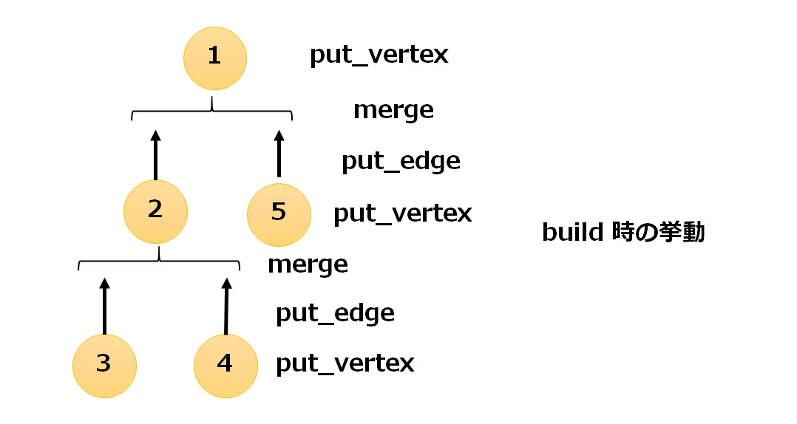
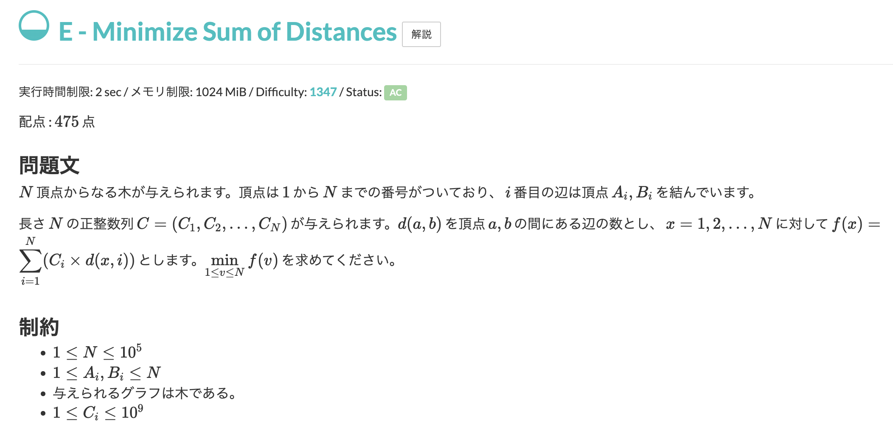

# rerooting.cppの使い方 (noyaさんライブラリ)

## コンストラクタ

```
RerootingDP<E, V, merge, e, put_edge, put_vertex> g(int n);
```

- 可換モノイドの型 `E`
- DPの値の型 `V`
- $\oplus:E \times E \rightarrow E$ を計算する関数 `E merge(E a, E b)`
- $e$ を返す関数 `E e()`
- 辺番号 $i$ の辺を付加する関数 `E put_edge(V x, int i)`
- 頂点番号 $v$ の頂点を付加する関数 `V put_vertex(E x, int v)`

を定義する必要があります。

- 頂点数 $n$ の木を作る準備をします。$n$ 頂点 $0$ 辺のグラフを作ります。
- デフォルトでは $n = 0$ です。

### 制約
$O(0 \le n \le 10^8)$
 
### 計算量
$O(n)$

## add_edge
```
void g.add_edge(int u, int v, int idx, int xdi)
```

- 頂点 $u$ から頂点 $v$ への辺番号が $idx$ である辺を追加します。
- 頂点 $v$ から頂点 $u$ への辺番号が $xdi$ である辺を追加します。

### 制約
- $0 \le u,v \le n$
- ちょうど $n−1$ 回 `add_edge` を呼んでできるグラフは連結（どの 2 頂点間にもパスが存在する）であり、その後 `add_edge` は呼ばれない。

### 計算量
ならし $O(1)$

## build
```
V g.build(int v)
```

- 上述した問題における $dfs(v,v)$ を返します。

### 制約
- `build` を呼ぶ前にちょうど $n−1$ 回 `add_edge` を呼んでいる。
- `build` は $1$ 回までしか呼ばれない。

### 計算量
$O(n)$

## reroot
```
vector<V> g.reroot()
```

- 長さ $n$ の配列 `answers` を返します。`answers[v]` は上述した問題における $dfs(v,v)$ です。

### 制約
- `reroot` を呼ぶ前にちょうど $1$ 回 `bulid` を呼んでいる。
- `reroot` は $1$ 回までしか呼ばれない。

### 計算量
$O(n)$

## 考え方

このライブラリでは、

- `merge`
- `e`
- `put_edge`
- `put_vertex`
という $4$ つの関数を設定します。`e` はいわゆる単位元で、それ以外の関数は下図のような感じです。



`put_edge` は辺を**またいだ**ときの処理、`put_vertex` は頂点に**到着した**ときの処理と考えると理解しやすいかなと思います。

## 例



```
struct S {
    ll sum;
    ll csum;
};
// 子部分木を合成する関数
S merge(S a, S b){
    return {a.sum + b.sum,a.csum+b.csum};
}

// 単位元（子部分木が存在しない場合）
S e(){
    return {0ll,0ll};
}

// 辺を遡って親頂点につながる時の関数　V→E
S put_edge(S v, int i){
    return {v.sum + v.csum,v.csum};
}

// 親頂点を含める時の関数　E→V
S put_vertex(S e, int v){
    return {e.sum,e.csum + C[v]};
}

int main(){
    ll N;
    cin >> N;
    RerootingDP<S,S,merge,e,put_edge,put_vertex> G(N);
    for (int i = 0; i < N-1; i++){
        ll a,b;
        cin >> a >> b;
        G.add_edge(a-1,b-1,i,i);
    }
    C.resize(N);
    rep(i,N)cin >> C[i];
    G.build();
    ll ans = INF;
    for (auto x : G.reroot()) chmin(ans,x.sum);

    cout << ans << endl;

}
```